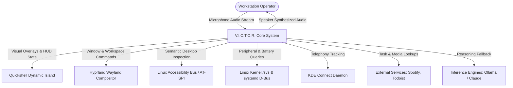
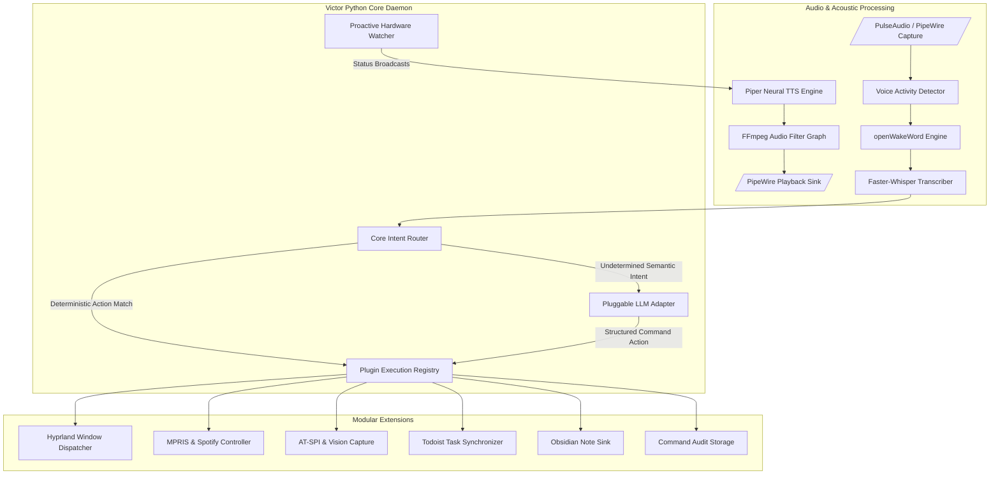
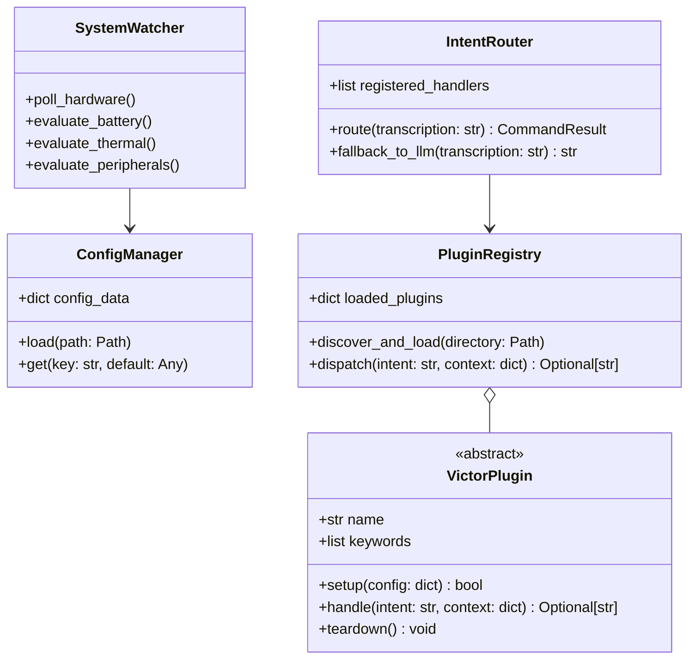
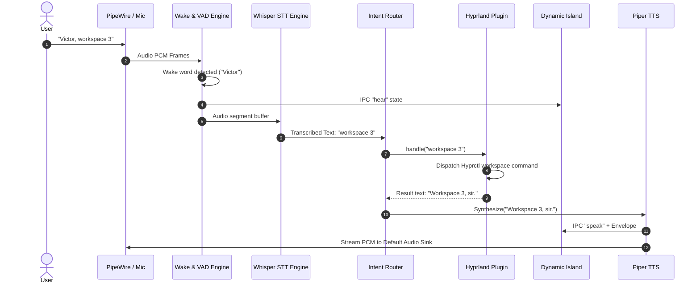

# V.I.C.T.O.R. System Architecture Document

## Overview
V.I.C.T.O.R. (Voice Intelligence for Contextual Tasks & OS Reasoning) is designed as a layered, asynchronous daemon system. It maintains low idle resource utilization on Linux workstations while delivering sub-second voice command parsing and active desktop awareness.

---

## 1. C4 Architecture Specification

### 1.1 Level 1: System Context Diagram

### 1.2 Level 2: Container Diagram

### 1.3 Level 3: Component Diagram (Core Layer)

---

## 2. Interaction Sequence: Voice Command Execution

---

## 3. Extensibility and Plugin Isolation Rules
* Plugins inherit from `victor.plugins.base.VictorPlugin`.
* Plugins are sandboxed against crashing the main loop: any unhandled exception inside a plugin's `handle()` method is captured, logged, and isolated.
* Plugins declare dependencies and trigger keywords in a declarative `PLUGIN.toml`.
