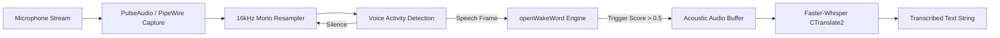

# Audio Pipeline Specification

## Audio Architecture Overview
The V.I.C.T.O.R. audio subsystem is built to operate under strict low-latency constraints while conserving CPU and battery resources during idle states.



## 1. Input Processing (Ears)

### Sample Rate and Channel Layout
* Format: Signed 16-bit PCM (`s16le`)
* Sample Rate: 16,000 Hz
* Channels: Single channel (Mono)
* Capture Tool: `parec` or `pw-record` integration with non-blocking POSIX pipes

### Wake-Word Detection
* Engine: `openwakeword` using pre-compiled ONNX models.
* Primary Hotword: `hey_jarvis` (compatible with `victor` phonetic aliases).
* Fast Path: Prediction score >= 0.5 immediately dispatches listening state.
* Verification Path: Prediction scores between 0.15 and 0.5 undergo second-pass verification via Whisper to compensate for non-native speech accents.

### Speech-to-Text Transcription
* Engine: `faster-whisper` based on CTranslate2.
* Model: `small` multilingual model quantized to INT8.
* Threading: Bound to 8 CPU threads with AVX-512 vectorization enabled.
* Beam Size: Constrained to 1 for lowest first-pass latency.

---

## 2. Output Synthesis (Voice)

### Neural Text-to-Speech
* Engine: `piper-tts` utilizing the high-quality ONNX checkpoint (`jarvis-high.onnx`).
* Pre-loading: The neural model weights are held in memory by the daemon to eliminate cold-start synthesis overhead.

### Audio Post-Processing Filter Graph
Synthesized output is processed through an FFmpeg audio filter graph to create an authoritative, resonant acoustic presence:
```
highpass=f=120, aecho=0.8:0.6:40|70:0.25|0.15, volume=1.2
```
* Highpass Filter: Cuts sub-120Hz rumble for clarity.
* Multi-tap Echo: Dual delays at 40ms and 70ms simulating an executive acoustic hall.
* Volume Gain: Boosts normalized amplitudes by 20%.

### Envelope Calculation for Dynamic Island
Audio output is downsampled into 50ms Root-Mean-Square (RMS) amplitude buckets normalized between 0.0 and 1.0. This array is emitted over IPC to the Quickshell UI to render real-time fluid waveform visualizers.
